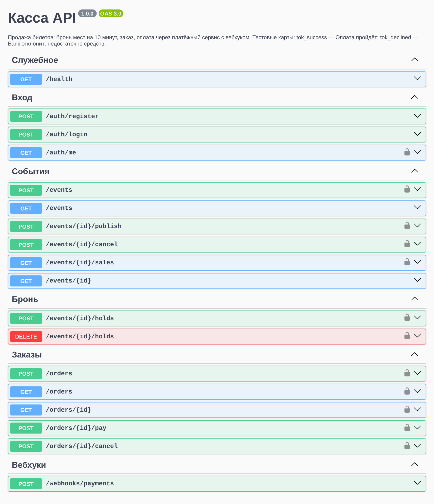
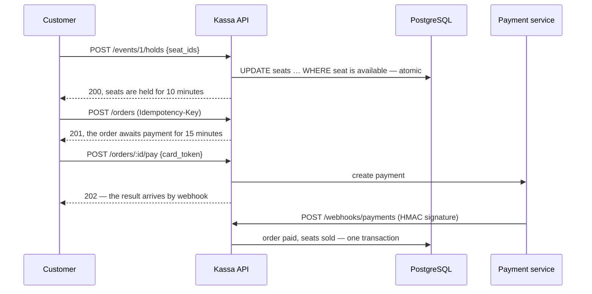

# Kassa — a ticketing API on Node.js and TypeScript

[](https://github.com/A160LKN/kassa-api/actions/workflows/ci.yml)

[Русский](README.md) · **English**

A backend for selling event tickets: seating plans, 10-minute seat holds, orders and payment through a payment service with a signed webhook. A domain where mistakes cost money: a seat must never be sold twice, money must never be charged twice, and a payment that arrives after the hold expired must be refunded. _Kassa_ means "box office".

**Stack:** Node.js 22, TypeScript (strict), Fastify, PostgreSQL, Drizzle ORM, Zod, OpenAPI · **Tests:** Vitest, fast-check, Allure · **Infrastructure:** Docker, GitHub Actions

**Live:** [API docs — try requests right in the browser](https://kassa-api-419n.onrender.com/docs). The free server sleeps when idle, so the first request can take up to a minute. Demo accounts: `organizer@kassa.kz` and `buyer@kassa.kz`, password `kassa-demo`. Test cards: `tok_success` — the payment goes through, `tok_declined` — the bank declines.



## How a purchase works



## Design decisions worth knowing

- **Double selling is impossible at the database level.** A hold is a single `UPDATE seats … WHERE seat is free OR the hold expired`. PostgreSQL updates the row one transaction at a time, and the second buyer no longer matches the condition — no `SELECT … FOR UPDATE`, no "check, then write" race. A `CHECK` constraint prevents a hold without an owner or an expiry.
- **An expired hold is free immediately**, right in the hold condition, not after a background sweep. The sweep only keeps the seating plan accurate, and it is safe with several processes because it is a single `UPDATE`.
- **The webhook is verified against the raw body signature**: a `t=…,v1=HMAC-SHA256("t.body")` header, like Stripe. The timestamp protects against replaying an intercepted request, and the comparison is constant-time. Repeats of the same event are rejected by the `event_id` primary key.
- **A payment after the order expired** does not sell the seats (someone may have bought them) — the order becomes `refunded`, and the refund is sent to the payment service after commit.
- **Idempotency-Key** on orders and payments: a repeat returns the stored response with `Idempotent-Replayed: true`, and the same key with a different body is a `422`. The key is claimed with `INSERT … ON CONFLICT DO NOTHING`, so two concurrent requests cannot both pass. 4xx errors are remembered, 5xx failures are not, so such a request can be retried.
- **Order statuses are a finite state machine**: "refund an unpaid order" or "pay a cancelled one" is impossible even by a bug in the code.
- **Cancelling an event** cancels unpaid orders and refunds paid ones.
- Password guessing is rate-limited (5 attempts per minute), someone else's order is `404`, not `403`, unknown request fields are an error rather than silently ignored, and every response carries `X-Request-Id` for log lookup. Settings are validated at startup: in production the server refuses to start with a default secret.
- The demo payment gateway sends its webhook **over HTTP** to the API itself, the same way a real service would.

## Tests — 107

| Level       | Tests              | What they check                                                                                                                                                                                                                                                                                                                    |
| ----------- | ------------------ | ---------------------------------------------------------------------------------------------------------------------------------------------------------------------------------------------------------------------------------------------------------------------------------------------------------------------------------- |
| Unit        | 27                 | all 25 "status × action" pairs; **fast-check**: across 2000 random action sequences money is never charged twice or refunded without payment; passwords, JWT (`alg=none`, expired, foreign secret), webhook signature (tampered body, foreign secret, replay after 10 minutes), settings                                           |
| Integration | 10                 | on PostgreSQL: **50 buyers hit one seat at the same time — exactly one gets it**; overlapping seat sets — all or nothing; 10 requests with one Idempotency-Key — one order; 5 identical webhooks at once — one payment; the sweep; an abandoned idempotency key does not block a retry, old keys are swept; the `CHECK` constraint |
| API         | 70                 | security headers, weak passwords and the sign-up limit, sign-in and rate limit, events and cursor pagination, holds, orders, payment: declined card and retry with another card, gateway down, late payment with refund, forged webhooks, event cancellation; **a real HTTP webhook** from the demo gateway                        |
| Smoke       | the whole purchase | the built Docker image in CI: sign in → hold → order → pay → webhook → `paid`                                                                                                                                                                                                                                                      |

Coverage is 96 % of lines; CI fails below 90 %. CI also checks that migrations match the schema.

**Reports from the latest run on `main`:** [Allure — all tests by section](https://a160lkn.github.io/kassa-api/) · [code coverage by file](https://a160lkn.github.io/kassa-api/coverage/)

More detail (in Russian) in the [test documentation](docs/testing/README.md): test strategy with risk analysis, a coverage matrix of 20 features, smoke and regression checklists.

### What I found while testing

- Every event in the listing showed "1 seat free" instead of 136: in a subquery the ORM emitted the `id` column without a table name, so the condition compared the seat with itself. Found by a manual smoke check, now covered by the pagination test, which also checks the seat count.

## Running locally

Requires Docker.

```bash
docker compose up --build --wait     # PostgreSQL and the API at http://localhost:3000/docs, with demo data
sh scripts/smoke.sh                  # the whole purchase against the running API
```

Development and tests (Node.js 22 and the database from `docker compose`):

```bash
npm install
npm run dev               # server with reload on changes
npm test                  # all tests
npm run test:coverage     # with coverage
npm run lint && npm run typecheck
```
