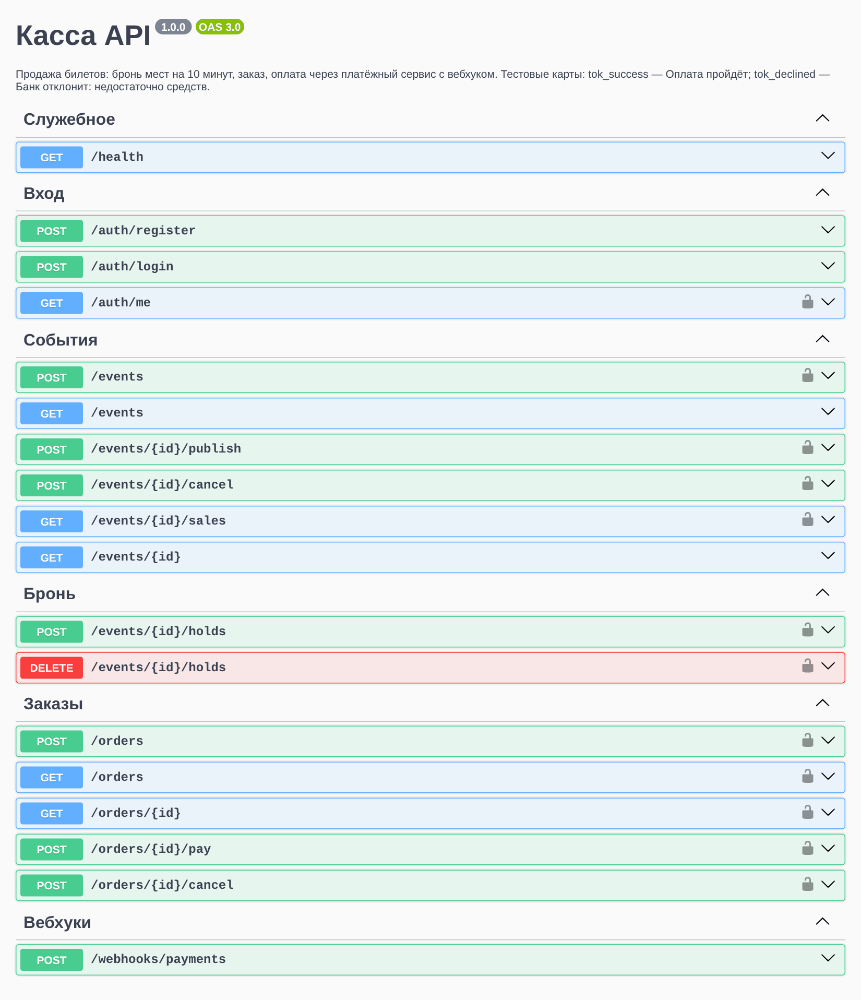
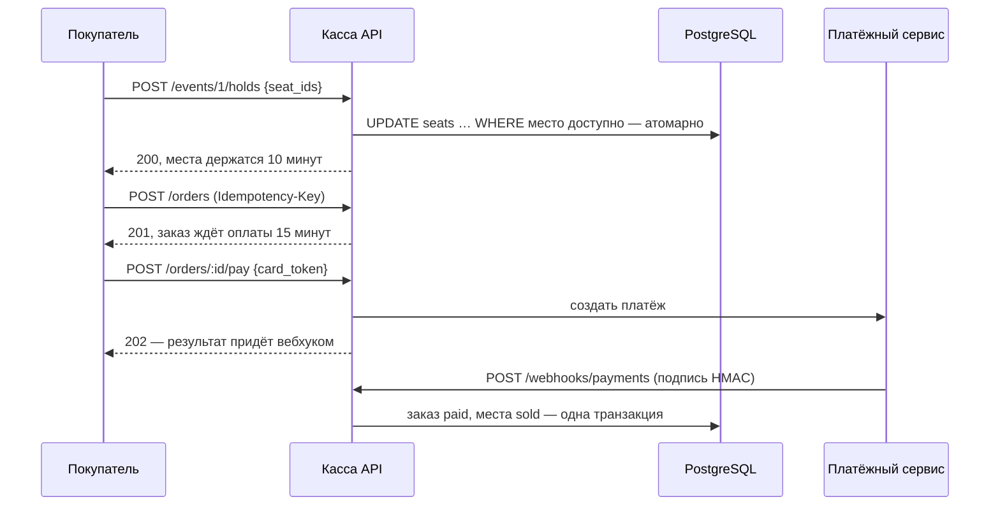

# Касса — API продажи билетов на Node.js и TypeScript

[](https://github.com/A160LKN/kassa-api/actions/workflows/ci.yml)

Бэкенд продажи билетов на мероприятия: схема зала, бронь мест на 10 минут, заказ и оплата через платёжный сервис с подписанным вебхуком. Предметная область, где ошибки стоят денег: одно место не должно продаться дважды, деньги не должны списаться дважды, а оплата после истечения брони должна вернуться покупателю.

**Стек:** Node.js 22, TypeScript (strict), Fastify, PostgreSQL, Drizzle ORM, Zod, OpenAPI · **Тесты:** Vitest, fast-check · **Инфраструктура:** Docker, GitHub Actions

**Работает онлайн:** [документация API — попробовать запросы прямо в браузере](https://kassa-api-419n.onrender.com/docs). Сервер на бесплатном хостинге засыпает после простоя, поэтому первый запрос может идти до минуты. Локально — `http://localhost:3000/docs`. Демо-аккаунты: `organizer@kassa.kz` и `buyer@kassa.kz`, пароль `kassa-demo`. Тестовые карты: `tok_success` — оплата пройдёт, `tok_declined` — банк отклонит.



## Как идёт покупка



## Решения, о которых стоит знать

- **Двойная продажа невозможна на уровне базы.** Бронь — один `UPDATE seats … WHERE место свободно OR бронь истекла`. PostgreSQL обновляет строку по очереди, и второй покупатель уже не проходит условие — без `SELECT … FOR UPDATE` и без гонки «проверил, потом записал». Ограничение `CHECK` не даёт записать бронь без владельца или срока.
- **Истёкшая бронь свободна сразу**, прямо в условии брони, а не после фоновой уборки. Уборка (`sweep`) нужна только чтобы схема зала показывала правду, и безопасна при нескольких процессах: это один `UPDATE`.
- **Вебхук проверяется по подписи сырого тела**: заголовок `t=…,v1=HMAC-SHA256("t.тело")`, как у Stripe. Время в подписи защищает от повтора перехваченного запроса, сравнение — без утечки по времени. Повтор того же события отсекает первичный ключ `event_id`.
- **Оплата после истечения заказа** не продаёт места (их могли уже купить) — заказ переходит в `refunded`, а возврат уходит в платёжный сервис после коммита.
- **Idempotency-Key** на заказ и оплату: повтор возвращает сохранённый ответ с заголовком `Idempotent-Replayed: true`, тот же ключ с другим телом — `422`. Ключ занимается вставкой с `ON CONFLICT DO NOTHING`, поэтому два одновременных запроса не пройдут оба. Ошибки 4xx запоминаются, сбои 5xx — нет: такой запрос можно повторить.
- **Статусы заказа — конечный автомат**: «вернуть деньги за неоплаченный» или «оплатить отменённый» невозможно даже по ошибке в коде.
- **Отмена события** отменяет неоплаченные заказы и возвращает деньги за оплаченные.
- Перебор паролей ограничен (5 попыток в минуту), чужой заказ — `404`, а не `403`, лишние поля в запросе — ошибка, а не тишина, у каждого ответа `X-Request-Id` для поиска в логах. Настройки проверяются при старте: в production сервер не запустится с секретом по умолчанию.
- Учебный платёжный шлюз для демо шлёт вебхук **по HTTP** на сам API тем же путём, что настоящий сервис.

## Тесты — 92

| Уровень        | Тестов            | Что проверяют                                                                                                                                                                                                                                                                              |
| -------------- | ----------------- | ------------------------------------------------------------------------------------------------------------------------------------------------------------------------------------------------------------------------------------------------------------------------------------------ |
| Юнит           | 27                | все 25 пар «статус × действие»; **fast-check**: на 2000 случайных последовательностей действий деньги не списываются дважды и не возвращаются без оплаты; пароли, JWT (`alg=none`, истёкший, чужой секрет), подпись вебхука (подмена тела, чужой секрет, повтор через 10 минут), настройки |
| Интеграционные | 8                 | на PostgreSQL: **50 покупателей одновременно на одно место — достаётся одному**; пересекающиеся наборы — всё или ничего; 10 запросов с одним Idempotency-Key — один заказ; 5 одинаковых вебхуков одновременно — одна оплата; уборка; ограничение `CHECK`                                   |
| API            | 57                | вход и лимит попыток, события и курсорная пагинация, бронь, заказы, оплата: отказ банка и повтор другой картой, недоступный шлюз, поздняя оплата с возвратом, поддельные вебхуки, отмена события; **настоящий HTTP-вебхук** от учебного шлюза                                              |
| Смоук          | весь путь покупки | собранный Docker-образ в CI: вход → бронь → заказ → оплата → вебхук → `paid`                                                                                                                                                                                                               |

Покрытие — 98 % строк; CI падает ниже 90 %. CI также проверяет, что миграции совпадают со схемой.

**Отчёты последнего прогона в `main`:** [Allure — все 92 теста по разделам](https://a160lkn.github.io/kassa-api/) · [покрытие кода по файлам](https://a160lkn.github.io/kassa-api/coverage/)

Подробно — в [тестовой документации](docs/testing/README.md): тест-стратегия с анализом рисков, матрица покрытия 20 функций, чек-листы смоука и регресса через Swagger.

### Что нашёл, пока проверял

- В афише у каждого события было «свободно 1 место» вместо 136: в подзапросе ORM подставил колонку `id` без имени таблицы, и условие сравнивало место само с собой. Нашёл смоук-проверкой руками, закрыто тестом пагинации, который проверяет и счётчик мест.

## Запуск

Нужен Docker.

```bash
docker compose up --build --wait     # PostgreSQL и API на http://localhost:3000/docs, с демо-данными
sh scripts/smoke.sh                  # весь путь покупки против запущенного API
```

Разработка и тесты (нужен Node.js 22 и база из `docker compose`):

```bash
npm install
npm run dev               # сервер с перезапуском при изменениях
npm test                  # все тесты
npm run test:coverage     # с покрытием
npm run lint && npm run typecheck
```

## Структура

```
src/
├── app.ts              — маршруты, проверка входных данных (Zod), OpenAPI, ошибки
├── domain/             — конечный автомат заказа
├── modules/            — бронь, заказы и вебхук, события, идемпотентность
├── gateway/            — платёжный сервис и учебный шлюз
├── lib/                — пароли, JWT, подпись вебхуков
├── jobs/               — уборка истёкших броней
└── db/                 — схема и миграции (Drizzle)
tests/
├── unit/               — автомат, безопасность, настройки
├── integration/        — гонки на PostgreSQL
└── api/                — HTTP целиком
```
